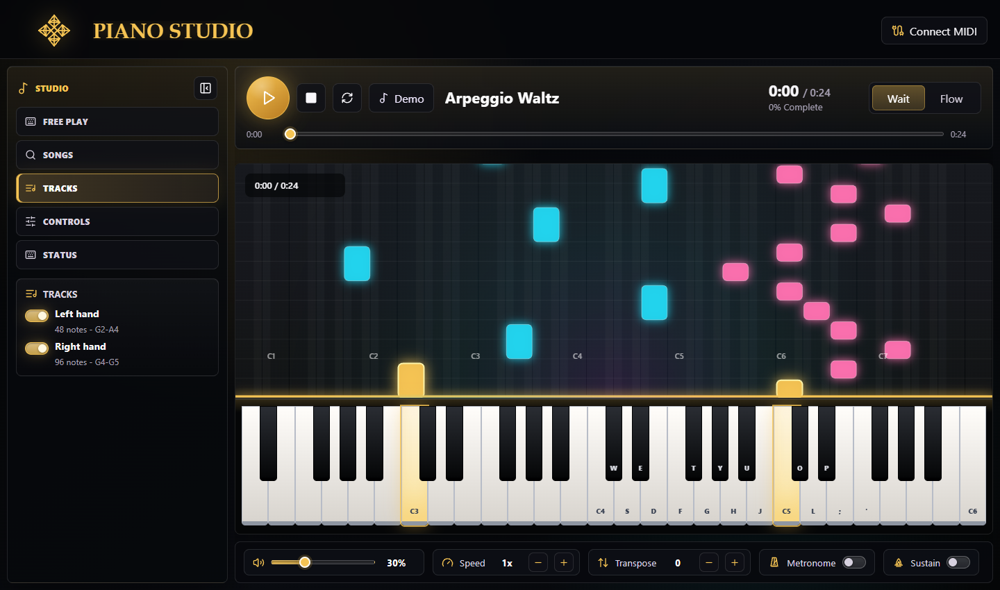

# Piano Studio

Piano Studio brings your MIDI songs to an on-screen piano. Follow the falling notes on your digital piano, play along with your computer keyboard, or click the keys to hear how a chord sounds.

**[Play Piano Studio](https://pianostudio-app.vercel.app/)**

## Inside the studio

- **Free Play** turns what you play into trails of light above the keys. With a MIDI piano connected, the sound responds to your touch and sustain pedal.
- **Song practice** starts with a song you find in the studio or a MIDI file you bring along. Listen to a demo of the whole piece, then pick the tracks you want to practice.
- **Wait and Flow** let you work on different skills. Wait pauses for each note or chord while you find the keys. Flow keeps the music moving so you can work on timing.
- **Passage loops** let you repeat a few bars. Slow them down to work out the fingering, then bring the tempo back up when both hands feel comfortable.
